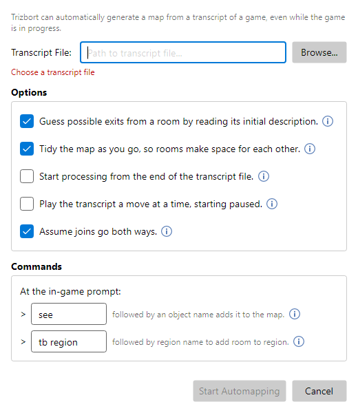
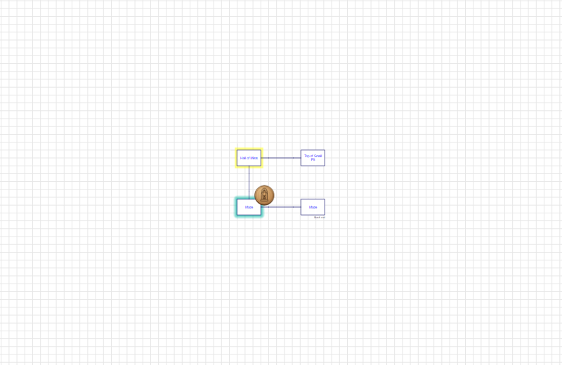
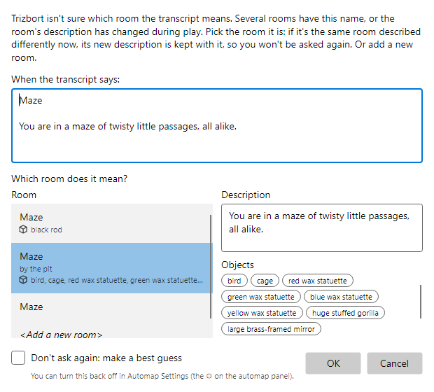
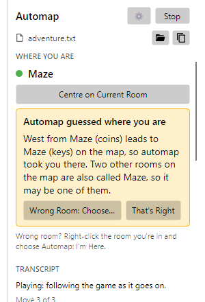
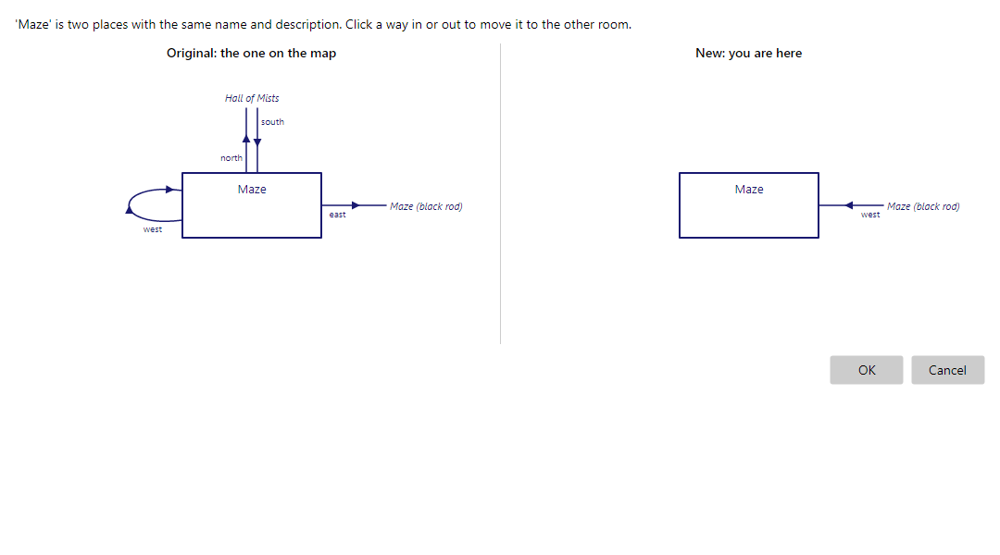

# Automap

[Back to the guide](index.md)

Automap draws the map while you play. It reads the game's *transcript*, the record of everything you typed and
everything the game said, and adds each room and the way you went. You can change the map as it goes.

## Transcripts

Most interpreters can save a transcript. In the game, type `SCRIPT` (or `SCRIPT ON`) and choose a file name.
Transcripts are plain text files, often ending `.txt`, `.scr` or `.log`:

```text
>LOOK
West of House
You are standing in an open field west of a white house, with a boarded front door.
There is a small mailbox here.

>NORTHEAST
North of House
You are facing the north side of a white house.
```

Automap works best when you also:

1. Type `VERBOSE`, so the game describes each room every time you enter it. Automap uses descriptions to tell rooms
   with the same name apart.
2. Type `LOOK` once the transcript has started, so automap can see where you are.

Automap can follow the game live as you play, or read a finished transcript afterwards. Interpreters such as Windows
Frotz, Gargoyle, Glulxe and Git write the transcript as you go, so automap keeps up; some only write every few
turns, so the map runs a little behind.

## Starting

Choose **Project > Automap > Start Automap...** and pick the transcript. It's often best to start with an empty map,
but you can open a map you automapped before and carry on: handy for a game you play over several weeks.



- **Guess possible exits** reads "To the east..." in a room's description and draws a short stub for each way out
  you haven't tried yet. It takes them away if you find you can't go that way. It can guess wrong ("To the east is an
  impassable pile of rubble"), so turn it off if you'd rather.
- **Tidy the map as you go** moves nearby rooms aside to make space for new ones. See [Tidying](#tidying).
- **Assume joins go both ways** (on): going north from one room to another also maps south as the way back. If it
  turns out to lead somewhere else, automap moves it. Turn it off for a maze of twisty passages.
- **Start processing from the end** maps only what you play from now on, leaving the map as it is. Leave it off and
  automap reads the whole transcript.
- **Play the transcript a move at a time** starts paused, to step through an old transcript.
- Hover over the **ⓘ** beside an option for more about it.
- **Commands:** type `see lamp` in the game and automap adds a lamp to the room; `tb region Cellars` puts the room in
  a region. The game won't understand them, and doesn't need to. Automap doesn't check the game's reply, so a typing
  mistake ends up on the map; delete it there. Change the commands to whatever you like.

## The automap panel

While automap runs, its controls sit in a panel beside the map.


- **The transcript's name** is at the top. **Open Folder** shows it in its folder.
- **Where you are** names the room you're in. On the map that room glows and carries a token, like a playing piece on
  a board. If automap has lost track, drag the token onto the right room, or right-click the room and choose
  **Automap: I'm Here**. The dot beside the name is green while automap is mapping, amber while it isn't changing the
  map, and grey in the dark. **Centre on Current Room** moves the map to it.
- **Somewhere not on the map?** **Add Current Room** puts it on the map beside the room you came from.
- **Transcript** steps through the game: **Next Move** (F10), **Previous Move** (F9), which goes back without
  changing the map, and **Pause**. "Move 12 of 4,567" counts the commands you typed.
- **Play to the End** (F5) plays every move left, showing its progress, and then follows the game as you play. The
  map can't be changed until it's done or you pause. With 20 or more moves left it asks first.
- **Go Live** appears when you've stepped to the end of the transcript and carried on playing: choose it to map each
  move as you play it.
- **Mapping / Tracking only**: tracking follows you round without changing the map. Use it to step through and check
  automap follows the rooms you expect; put the map right if not, then switch back to Mapping.
- The little **game screen** shows the game so far. Click it for a bigger one you can copy from, or drag the panel's
  left edge to widen it.
- The **⚙** changes the settings while automap runs.

However far out you zoom, the token stays big enough to find:



Choose a different token, or load your own picture, in [App Settings > Map](settings.md#app-settings).

## When automap isn't sure

### Which room is it?

Games are full of rooms with the same name: "Maze", "Corridor". Automap tells them apart by the map first (where the
way you went leads), then by their descriptions. When it still can't tell, it asks:



Each room is listed with its subtitle and objects, and the ways out of it where that's what tells it apart. Click one
to see its description, and the map behind the dialog shows it. Pick the room you're in, or
**<Add a new room>**. A room the game now describes differently (the Twopit Room once the beanstalk has grown) is the
same room at another time: pick it, and automap remembers the new description too.

- **Cancel** maps nothing for this move. Automap carries on from the next room it can place.
- **Don't ask again: make a best guess** stops the questions for the rest of this run: the room whose description
  starts the same way, else a new room.

When automap decides for itself and it could be wrong, it says what it guessed and why:



Choose **That's Right**, or **Wrong Room: Choose...** to put it right.

### A way out leads somewhere new

You went east from the Hall to the Pantry before, and now east leads to the Kitchen. Automap stops and asks:

- **Both Are Right**: the way leads to either, depending on something in the game, or they're one place at different
  times (a dry riverbed that floods once the dam is opened). Both joins stay. Next time automap goes by the room the
  game names.
- **'Hall' Moves**: the room is a lift or a vehicle. See [Rooms that move](#rooms-that-move).
- **A Different 'Hall'**: you were in another room with the same name. Automap adds it and moves the way you came in
  over to it.

A way back that automap only assumed isn't something you saw, so when it turns out to lead somewhere else, automap
just puts it right.

## Rooms that move

A lift, a car or a train takes you with it: you get in, it moves, and you get out somewhere else. Choose
**'Closet' Moves** when automap asks, or tick **Moves** in the room's properties.

- Automap adds a copy of the room at each place it stops, a *stop*, joined from the room by what moved it.
- It asks **What moved it?**, listing the commands you typed in the room with its best guess picked. Choose
  **Nothing I did** for something that moves by itself (the join is labelled "(by itself)"), or **Something else...**
  to type it.
- From then on automap works out which stop you're at from the way you go out, and asks nothing more as you ride up
  and down. Typing a command it knows moves you to the other stop straight away.
- A moving room and its stops show a small blue sign with up and down arrows. **Ctrl+click** a stop to go to the room.
- If automap didn't see the room move (you pulled the peg and walked out without going back), right-click the room and
  choose **Room > Add Another Stop**. Drag the new stop to where it went.
- A join between stops labelled with the wrong command? Clear its label, or delete it, and automap asks again next
  time.

## Putting the map right

### Splitting a room

Found out a few moves later that one room on the map is really two places? Right-click it and choose
**Split Room...**. Click each way in or out to move it to the new room.



The original is on the left with its objects, and the new room on the right. Moving only one half of a two-way join
splits it into two one-way joins. If automap has you in the room, you're in the new one; if you're really in the
original, right-click it and choose **Automap: I'm Here**.

### Merging rooms

A place on the map twice? Select both rooms, the one to keep last, and choose **Rooms > Merge Rooms**. The other
room's joins, descriptions and objects move onto the one you keep.

### Rooms automap can't map

For a maze, or a room automap can't make sense of, tick **Don't automap from here** in its properties (or choose
**Automap > Disable Automap on This Room** on its right-click menu). It shows a small amber "no entry" sign. While
you're there automap maps nothing; when you come out it carries on, with a dotted "?" join for the way through if the
room is new. Relabel the join when you've worked out the way.

### Dark rooms

A heading that says it's too dark to see ("Darkness", "It is pitch black") isn't mapped as a room. When you light the
lamp, the room you see is mapped as reached the way you came, and marked Dark.

### Areas of their own

Some parts of a game feel like a map of their own, such as the inside of a house after the gardens. Select the first
room of that part (the Foyer), right-click and choose **Rooms > Move to a New Area...**. The rooms move aside together,
and their joins to the rooms left behind are *split*: drawn as a short stub at each end, labelled with the room at the
other end ("to Front Porch"). They're still the same joins, so automap follows them, and maps new rooms in the new
area. Click a stub's label to go to the room it names.

### Copies of rooms

A room can stand for another: set **Reference** in its properties. It's drawn "To Front Porch", in the other room's
look, and **Ctrl+click** goes there. A moving room's stops are copies too. A copy's right-click menu can go to the room
it stands for, move its joins onto that room, or make it a room of its own.

## Tidying

With **Tidy the map as you go** on, after each move the rooms nearby shift so joins point the way their directions
say, never run across a room, and cross each other as little as possible. The rooms slide to their new places, so you
can follow where they went. A new room goes on the map straight away and the tidy follows a moment later, as its own
undo step: undo a tidy you don't like and the new room stays where automap put it.

A room you've moved yourself stays where you put it, though it slides aside if a new room needs its place. To tidy the
whole map, or just some rooms, choose **Rooms > Tidy Map...**: **step by step** keeps the map familiar, and the
**solver** lays everything out again.

## How automap reads the game

Automap works things out from the text, and can be wrong. If it gets something wrong that it should have got right,
[let us know](https://github.com/leeoades/trizbort/issues).

- **Room names** are headings: short lines of words with capitals ("West of House"), grid references ("Y2"), or names
  with a part after a comma ("Garden, north"). It leaves off endings such as " (on the bed)" or ", under the table".
  Sometimes it takes the game's title for a room: delete it.
- **Moving:** compass directions, up, down, in and out, with or without `go` or `walk`, and `port`, `starboard`, `fore`
  and `aft` (and their short forms). Up, down, in and out label their joins.
- **Anything else** that takes you to a new room (`xyzzy`, `enter boat`) joins it from where you were, labelled with
  what you typed. Automap follows joins labelled with a command: type it again and it moves you along the join.
- **Joins it made:** it remembers each way along a join, from which end, and whether you went that way or it only
  assumed it. The labels are drawn from those. A join you draw yourself, or whose labels or ends you change, is read
  from its labels and sides, so what you write is what counts.
- **Games it can't map:** ones without a `>` prompt, or that don't give rooms names, or that move you about in their
  own ways.

## Tips

- Move with plain directions (`north`, `n`, `up`) where you can, especially the first time you go somewhere: automap
  places a room by the way you went to it. Go through a doorway to the north with `north` rather than `in`.
- One command at a prompt. Automap can't tell which part of the reply goes with which of `n. e. get lamp`.
- Move rooms around as you like: automap only cares about the joins. Rooms you move yourself stay put.
- Delete anything automap got wrong, rooms or joins. It only puts them back if you go that way again.
- Check where a new room went on a busy map, and move it somewhere clearer straight away: that helps automap place
  the next ones well.
- **Moving a join's end:** automap reuses a join that leaves from the same side of the room (a south join can start
  at SSE or SSW, but not SE or SW). Move it to another side and automap draws a new one next time you go that way.
  Joins for up, down, in and out can use any port.

Next: [Settings](settings.md)
