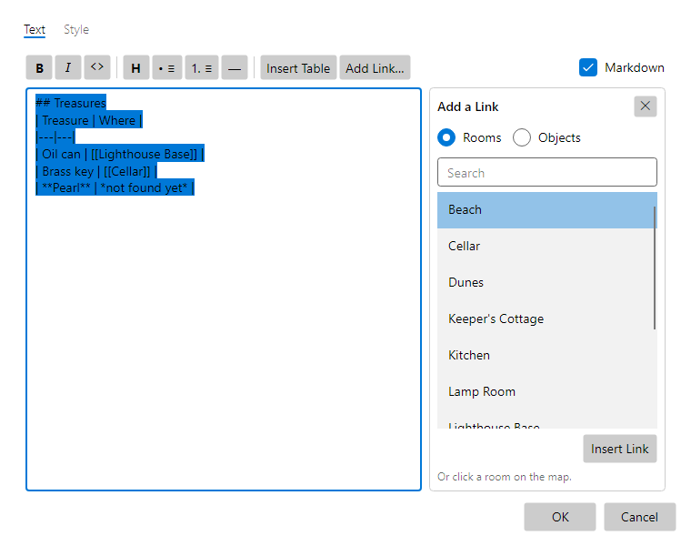
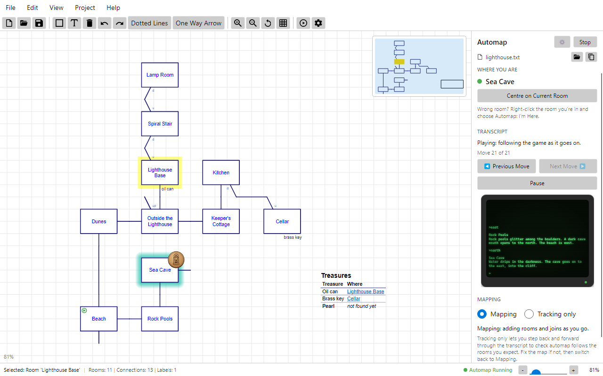
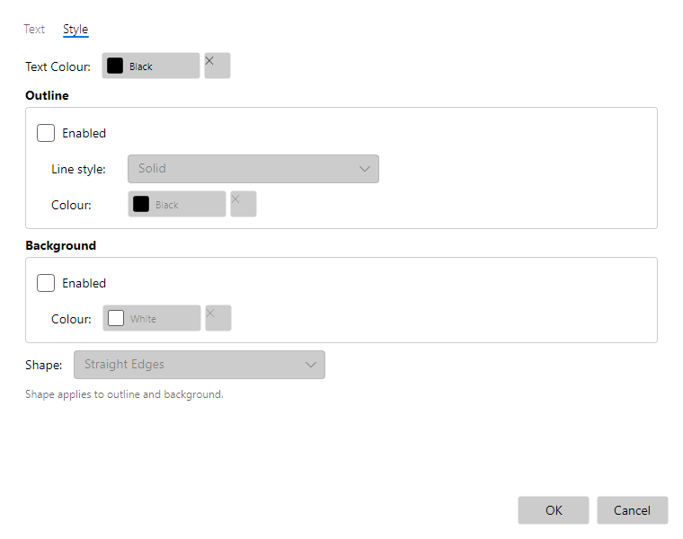

# Labels

[Back to the guide](index.md)

Labels are notes on the map: a title, a list of treasures, a reminder of a puzzle. Press **L** to add one where the
mouse is, or right-click and choose **Add Label**. Double-click a label to edit it.

## Formatting with Markdown

Tick **Markdown** to format the text. You don't need to remember the marks: the toolbar puts them in for you.

- **B**, **I** and **<>** make the selected words bold, italic or code (**Ctrl+B**, **Ctrl+I**).
- **H** makes a heading, the list buttons make a bulleted or numbered list, and **—** draws a line across.
- **Insert Table** puts in a small table to type over.
- **Add Link...** (**Ctrl+K**) lists the map's rooms or objects. Search, pick one and press **Insert Link**, or click
  a room on the map. Click a room link on the map to go to that room.

On the map, the table above looks like this:

If you'd rather type the marks: `## Heading`, `**bold**`, `*italic*`, `- list`, `[[Room name]]` for a room link and
`[words](https://...)` for a web link.

## Style

Choose the text colour, and turn the outline and background on or off. The shape (straight edges, rounded,
ellipse or octagon) applies to both.

## Size

A label grows as you type, and shrinks back as you delete, but never smaller than you made it. Drag its handles to
resize it yourself.

Labels can be joined to rooms like a room can, and appear in image and PDF exports. They aren't exported to game
source.

Next: [Automap](automap.md)
