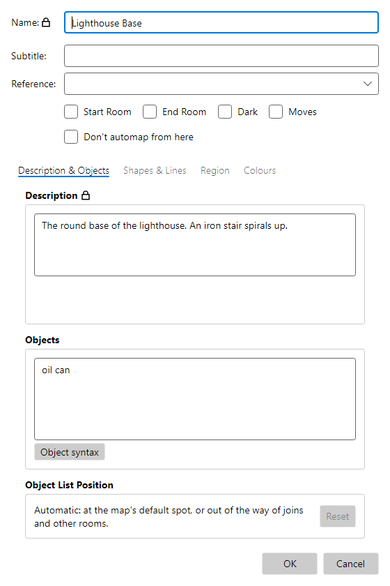
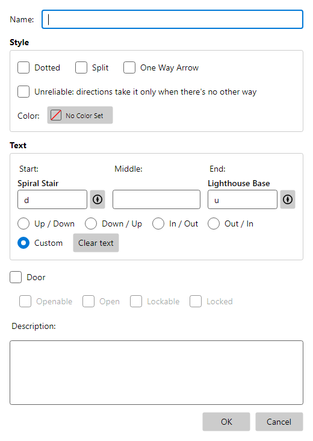
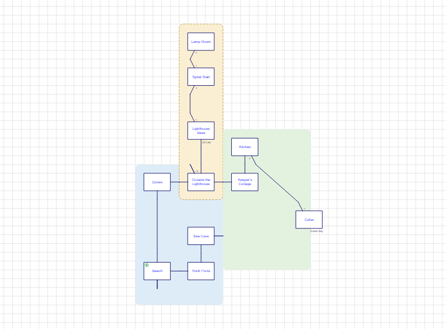
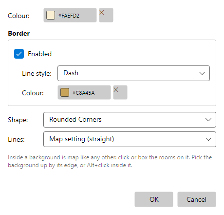
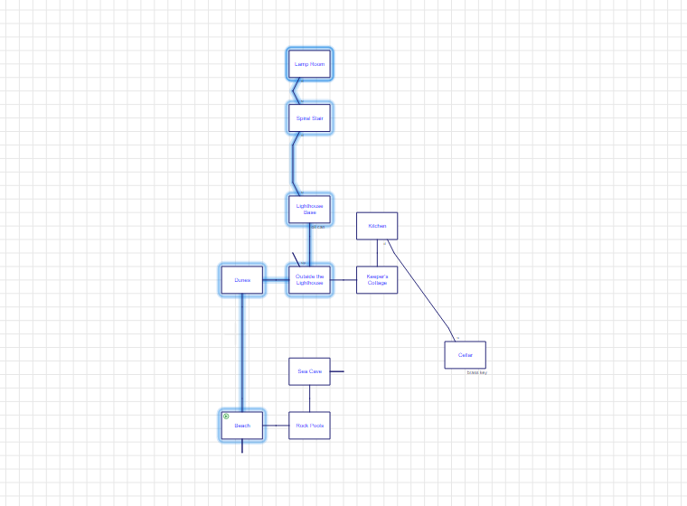

# Drawing the map

[Back to the guide](index.md)

A map is rooms and the joins between them, with labels and backgrounds to explain it. Draw it as you play, or let
[Automap](automap.md) draw it for you.


*The garden lists its objects (the spade is in the wheelbarrow). The cellar is dark. The way out of the window is
one way, and the dotted grating is a way not tried yet, bent to keep it clear.*

## Rooms

- **Add a room:** double-click an empty spot, press **R** where the mouse is, or right-click and choose
  **Add Room**. With a join selected, **R** puts the new room in the middle of the join.
- **A new room is the size of the last room you selected.** Turn on **Apply style to new rooms** (Application
  Settings, Map) and it takes that room's look too: shape, border, colours, region and darkness, but not its name or
  objects.
- **Move it:** drag it, or press the arrow keys. **Resize it:** drag one of the handles round a selected room, or press
  **Ctrl+Alt+arrow**.
- **Rename it:** press **F2**. **Its properties:** double-click it, or press **Alt+Enter**.
- **Delete it:** press **Delete**. Its joins go with it. **Ctrl+Z** brings it back.

Rooms can touch or overlap, and the map goes on as far as you need.

### Room Properties



At the top:

- **Name**, and a **Subtitle** drawn under it on the map ("by the pit"). The subtitle isn't exported to game source.
- **Start Room** and **End Room**: where the game starts and ends.
- **Dark**: the room is drawn with a dark corner. **K** turns it on and off on the map.
- **Moves**: a lift, a car or a train, a room that takes you with it. Automap shows it at each stop as a copy with
  its name (see [Automap](automap.md)).
- **Don't automap from here**: for a maze, or anywhere automap can't follow.

A padlock beside the name means automap drew this room and knows it again by its name and description. Click the
padlock to unlock them if you need to change them. Where the game has described the room more than one way, the other
descriptions are listed under **Also described as**.

The dialog opens on the tab you used last:

- **Description & Objects**: the room's description (shown when you hover over the room, and exported to game
  source), and what's in it.
- **Shapes & Lines**: the border (solid, dashed, dotted and so on, or none), whether it's drawn hand-drawn or
  straight, and its shape: straight edges, rounded, an ellipse or an octagon. Rounded corners can each be their own
  size.
- **Region**: which [region](#regions) it's in.
- **Colours**: the room's fill, a second fill along one side or corner (water beside a room, say), its border, and its
  name, subtitle and object text. Leave a colour as **Default** to take it from the region or the map.

Select several rooms and choose **Properties...** to set their darkness, shape, lines, region and colours all at
once. It has the same tabs as one room's properties, without what only one room can have (its name, description and
objects). Anything they differ on shows as **Mixed**, and stays as each room has it unless you change it.


### Objects

Put one object a line. To show that something is inside, on top of, or carried by the object above it, start its line
with **-** (and **--** for one inside that):

```
Mr Jones
- hat
-- hatband
- goldfish bowl
Mrs Jones
```

**Tab** and **Shift+Tab** indent and outdent the line for you. After the name you can add properties in square
brackets, such as **[c]** for a container or **[m]** for a man: **Object syntax** above the list shows them all.
They're used when exporting to game source and don't show on the map.

On the map the list goes below the room, or wherever the map's default is (Map Settings, Rooms), and moves to another
side if that spot would cross a join or another room. Drag a list to put it somewhere else, inside the room too once
it's selected. **Reset Object List Position** (the room's right-click menu, Room) puts it back.

### Hovering over a room

Hover over a room to see its name, whether it's dark, its region, its description and its objects. Choose what's shown
in Application Settings, Tooltips.

## Joins

A join is a way from one room to another.

- **Draw one:** with nothing selected, hover over a room to see its sixteen ports, the dots round its edge. Drag from a
  port to a port of another room.
- **Or from the keyboard:** select two rooms and press **J**, or press **Ctrl+arrow** from a room to join it to the
  room that way, adding the room if there isn't one.
- **Move an end:** select the join, then drag the dot at its end to another port.
- **Delete it:** select it and press **Delete**. **Alt+Delete** deletes all the joins of the selected room.
- **Tidy where joins meet a room:** **;** (Adjust Ports) moves them to the ports that face the rooms they go to.



Double-click a join, or press **Alt+Enter**, for its properties:

- **Text** labels each end ("u" and "d" here) and the middle ("pull lever"). The compass button beside each end picks
  directions to type there (and a spell, in **Custom**), and the buttons below fill in the usual pairs. Start is the
  room on the left, or the upper one.
- **One Way Arrow** for a way you can't come back along. It points from the start room to the end room; **Flip** turns
  it round.
- **Dotted** for a way you're not sure of, **Split** to draw a long join as a short stub at each end
  ("to Building").
- **Unreliable** for a way that doesn't always lead where it's drawn (the game picks at random). Directions only
  take it when there's no other way.
- **Color**, and **Door** for a door, which can be openable, lockable and so on. Doors are exported to game source.

A label that would sit on a line, a room or another label moves out of the way by itself.

On the map, with a join selected:

| Key | Does |
|---|---|
| **P** | Plain: solid, two way, no labels |
| **T** | Dotted, or solid again |
| **A** | One way, or two way again |
| **V** | Reverse it, swapping the labels at each end |
| **U**, **D**, **I**, **O** | Label it up and down, down and up, in and out, or out and in |

**P**, **T** and **A** also set how the next join you draw starts out.

**Bend a join:** select it and drag the handle in its middle. Once it's bent, two more handles appear, a quarter of the
way along from each end, so you can shape it further. Click a handle and press **Delete** to take it out.

**Split joins:** click the label at the end of a stub ("to Building") to go to the room it names, or drag the label to
move it. Right-click a split join and choose **Bring 'X' to 'Y'...** to put the two rooms back side by side.

When you export to game source, a join's ports are read as the nearest compass direction (east-northeast is east), and
its labels for up, down, in and out.

## Regions

A region is a group of rooms drawn in their own colours: "Above ground", "The cellars". Select some rooms,
right-click and choose **Set Region**, then a region, or **Add New Region...** to make one for them: name it and
choose its colours, and press OK. **Change Region** (**Shift+F2**) does the same from the keyboard, and the region
list in **Properties** ends with **Add New Region...** too.

Rooms not in a region are in **No Region**. Change or delete regions in **Map Settings > Regions**.
**Ctrl+Shift+A** selects every room in the regions of the rooms you've selected.

## Backgrounds

A background is a coloured shape behind part of the map: the shore, the lighthouse, the cottage. It sets them apart
whatever regions the rooms are in.



- **Add one:** select the rooms it should go behind and press **B** (or right-click and choose
  **Add Background**). It's drawn round them, with a little to spare. With nothing selected, it goes where the
  mouse is.
- **Inside a background is map like any other:** click rooms on it, double-click to add one, or drag a box round
  them.
- **Pick it up** by its edge, or **Alt+click** inside it. Drag it to move it (the rooms stay where they are), or drag
  its handles to resize it. **Delete** removes it.
- **Its properties** (double-click its edge, or **Alt+Enter**): colour, border, shape, and hand-drawn or straight
  lines.



## Selecting

- **Click** something to select it. **Shift+click** adds to what's selected, and **Ctrl+click** takes away from it.
  The pointer shows a **+** or a **-** while you hold the key.
- **Drag a box** from an empty spot to select everything in or touching it. Hold **Shift** to add to the selection,
  or **Ctrl** to take away.
- **Ctrl+A** selects everything, and **Esc** nothing. **0** selects the start room.
- With nothing selected, **Enter** selects the room nearest the middle of the window.
- **The number pad** (or the arrow keys) moves the selection to the room in that direction, along a join if there is
  one. **Ctrl** with it follows the join, joins the room that way, or adds a new room there and opens its
  properties to name it: a quick way to sketch a map from the keyboard. **Shift+arrow** selects the join that way.

Most things work on everything selected at once: dragging, **Delete**, dark (**K**), the join keys above, region,
shape and colours. Dragging rooms brings the joins between them along.

## Moving round the map

- **Pan:** drag with the middle mouse button, or the right one, or hold **Space** and drag. With nothing selected,
  the arrow keys pan too. **The minimap** in the corner shows the whole map: click or drag in it to go there.
- **Zoom:** the scroll wheel zooms, or pans on a trackpad (choose which in Application Settings: **Scroll wheel /
  trackpad scroll**). **Ctrl** with the wheel always zooms, and so do **Ctrl+Plus** and **Ctrl+Minus**.
- **Ctrl+0** zooms to 100%, **Ctrl+Home** fits the whole map in the window, and **Home** goes back to the middle of
  the map.
- **Quick Find** (**Ctrl+F**) finds a room by name.

## Rearranging

On a room's right-click menu:

- **Swap**: with two rooms selected, swap their objects (**W**), names (**Ctrl+W**), looks (**Shift+W**) or regions
  (**Alt+W**).
- **Rooms > Merge Rooms** turns two copies of a place into one: the room selected last keeps the others' joins,
  descriptions and objects. **Split Room...** turns one room into two.
- **Rooms > Move to a New Area...** moves the selected rooms aside together, so a part of the game (inside the house)
  has room of its own. It offers to take the rooms beyond them too, and splits the joins left behind.
- **Rooms > Tidy Map...** lines the rooms up and untangles the joins: the whole map, or just the rooms you've
  selected. Rooms you've placed yourself stay where you put them.
- **Arrange** brings a room or label to the front, or sends it to the back.

## Directions

Need to get from one room to another? Right-click where you want to go and choose **Navigate to Here**. The
**Directions** panel lists the commands to type, and the route glows on the map.



- While automapping, the directions start from where you are, and follow you as you play.
- Otherwise, choose **Navigate from Here...** on the room to start from.
- **Copy Commands** copies them, one a line, to paste into the game.
- Right-click a step and choose **Avoid This Route** to go another way.

Next: [Labels](labels.md)
