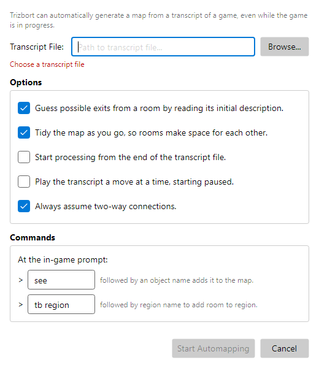
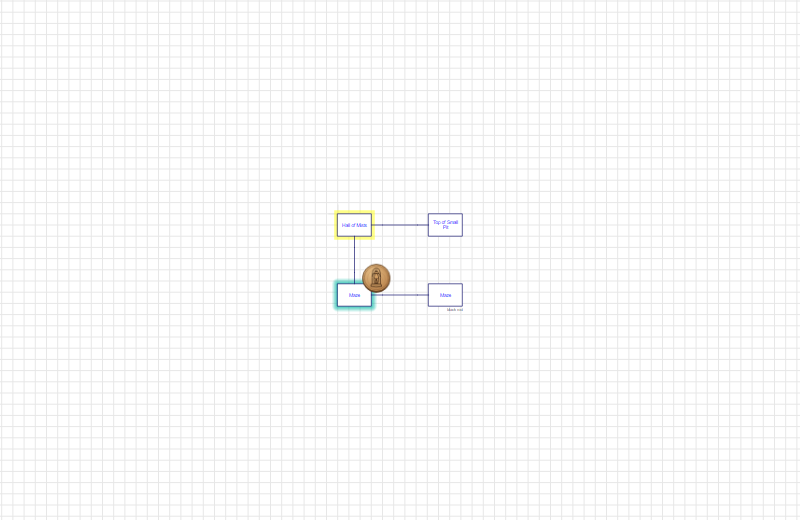
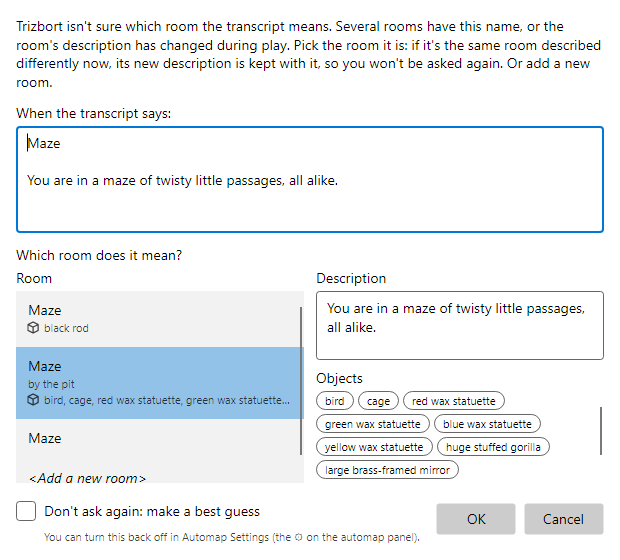
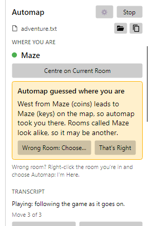
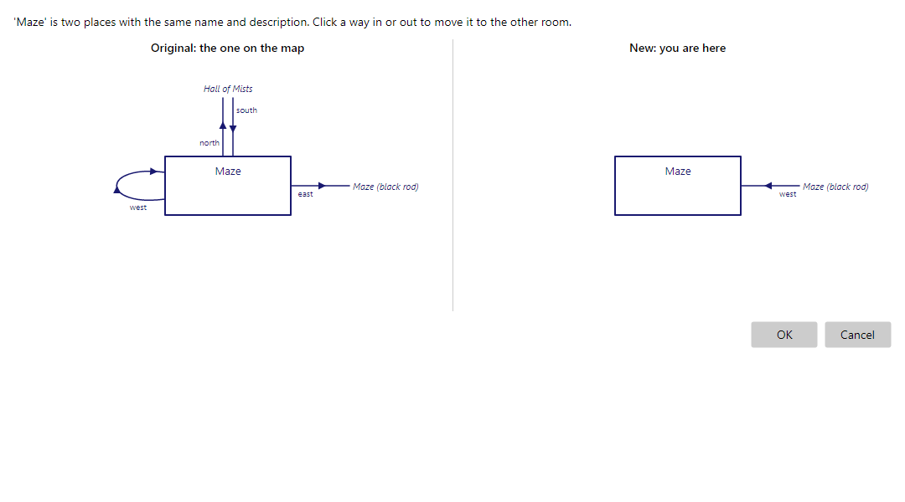

# Automap

[Back to the guide](index.md)

Automap draws the map while you play. It reads the game's *transcript*, the record of everything you typed and
everything the game said, and adds each room and the way you went.

## Before you start

1. In your game, type `SCRIPT` (or `SCRIPT ON`) and choose a file name. Most interpreters can do this.
2. Type `VERBOSE`, so the game describes each room every time you enter it. Automap uses descriptions to tell rooms
   with the same name apart.
3. Type `LOOK`, so automap can see where you are.

## Starting

Choose **Project > Automap > Start Automap...** and pick the transcript.

- **Guess possible exits** reads "To the east..." in a room's description and draws a short stub for each way out
  you haven't tried yet.
- **Tidy the map as you go** moves nearby rooms aside to make space for new ones.
- **Start processing from the end** maps only what you play from now on, leaving the map as it is.
- **Play the transcript a move at a time** starts paused, to step through an old transcript.
- **Commands:** type `see lamp` in the game and automap adds a lamp to the room; `tb region Cellars` puts the room in
  a region. The game won't understand them, and doesn't need to.

## The automap panel

While automap runs, its controls sit in a panel beside the map.

- **Where you are** names the room you're in. On the map that room glows and carries a token, like a playing piece on
  a board. If automap has lost track, drag the token onto the right room.
- **Transcript** steps through the game: **Next Move** (F10), **Previous Move** (F9) and **Play to the End** (F5).
- **Mapping / Tracking only**: tracking follows you round without changing the map.
- The little **game screen** shows the game so far. Click it for a bigger one.
- The **⚙** changes the settings while automap runs.

However far out you zoom, the token stays big enough to find:

Choose a different token, or load your own picture, in [App Settings > Map](settings.md#app-settings).

## When automap isn't sure

Games are full of rooms with the same name: "Maze", "Corridor". Automap tells them apart by the way you went and by
their descriptions. When it still can't tell, it asks:

Pick the room you're in, or **<Add a new room>**. The map behind the dialog shows the room you pick.

When automap decides for itself and it could be wrong, it says what it guessed and why:

Choose **That's Right**, or **Wrong Room: Choose...** to put it right.

## Splitting a room

Found out a few moves later that one room on the map is really two places? Right-click it and choose
**Split Room...**. Click each way in or out to move it to the new room.

## Tips

- Move with plain directions (`north`, `n`, `up`) where you can. Automap places a room by the way you went to it.
- One command at a prompt. Automap can't tell which part of the reply goes with which of `n. e. get lamp`.
- Move rooms around as you like: automap only cares about the joins. Rooms you move yourself stay put.
- Delete anything automap got wrong. It only puts things back if you go that way again.
- For a room automap can't make sense of (a lift, a maze), tick **Don't automap from here** in its properties.

The [original guide](../legacy/Docs/index.md#help_automap) explains more of how automap works, and what to do when it
doesn't.

Next: [Settings](settings.md)
