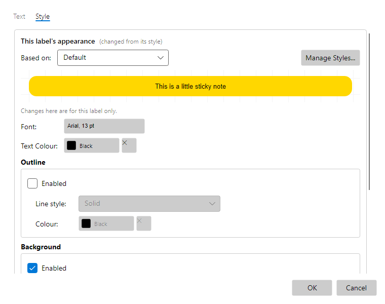

# Labels

[Back to the guide](index.md)

Labels are notes on the map: a title, a list of treasures, a reminder of a puzzle. Press **L** to add one where the
mouse is, or right-click and choose **Add Label**. Double-click a label to edit it.

## Formatting with Markdown

Tick **Markdown** to format the text. You don't need to remember the marks: the toolbar puts them in for you.

- **B**, **I** and **<>** make the selected words bold, italic or code (**Ctrl+B**, **Ctrl+I**).
- **H** makes a heading, the list buttons make a bulleted or numbered list, and **—** draws a line across.
- **Insert Table** puts in a small table to type over.
- **Add Link...** (**Ctrl+K**) lists the map's rooms or objects. Search, pick one and press **Insert Link**, or click
  a room on the map. Select some words first and they become the link. Click a room link on the map to go to that
  room.

On the map, the table above looks like this:

If you'd rather type the marks:

- **Headings:** `# Treasures`, `## Above ground`.
- **Bold, italic and code:** `**bold**`, `*italic*`, `` `code` ``.
- **Lists:** `- lamp`, or `1. first`. Put two spaces before a line for a list inside a list.
- **A line across:** `---`.
- **A table:** a row a line, with the cells between `|`s, and `|---|---|` under the first row to make it the heading.
- **A link to a room:** `[[Giant Room]]`, or `[[Giant Room|the giant's room]]` to show other words.
- **A web link:** `[the walkthrough](https://...)`.

Rooms with the same name ("Maze") have their number in the link: `[[Maze#42]]`. Right-click a room and choose **Copy
Room Link** to get its link, then paste it into the label.

A Markdown label's text starts at its top left. Older versions of Trizbort show the text as written.

## Styles

A label's look comes from a **style**: "Title", "Note", whatever the map needs. The label's **Style** tab shows the
label's text in each of the map's styles: click the one you want. Change a style and every label using it changes
with it.

**Manage Styles...** opens the styles in Map Settings (see [Settings](settings.md#styles)). A style sets the font
and size, bold and italic, the text colour, the outline, the background, the shape (straight edges, rounded,
ellipse or octagon), and where the text sits: **Text Align** has buttons for left, centre or right, and below them
top, middle or bottom. With none lit, the text sits as labels always have: centred, or top left for Markdown. Click a
lit button again to go back to that.

If one label really must be different, choose **Modify this label's appearance...**. The list of styles gives way to
**Based on**, the style it starts from, with a preview of the label as it will look and the settings to change.

OK keeps the changes and Cancel throws them away. It's better to make a style, so labels stay alike: **Save as a New
Style...** opens Manage Styles at a new style with the label's look. Name it and press OK, and the label uses it.
**Reset to Style** takes the label back to its style and lists the styles again. A label that's been changed this way opens at its own settings.

## Size

A label grows as you type, and shrinks back as you delete, but never smaller than you made it. Drag its handles to
resize it yourself.

Labels can be joined to rooms: with nothing selected, drag from one of the label's ports to a room. They appear in
image and PDF exports, but aren't exported to game source. Select, move, copy and delete them as you would rooms.

Older versions of Trizbort ignore labels. Opening a map with labels in them is safe, but saving it there loses the
labels and their joins.

Next: [Automap](automap.md)
