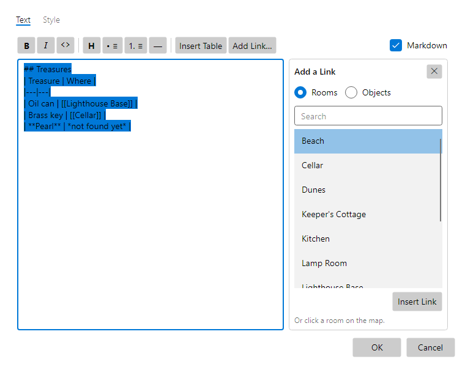
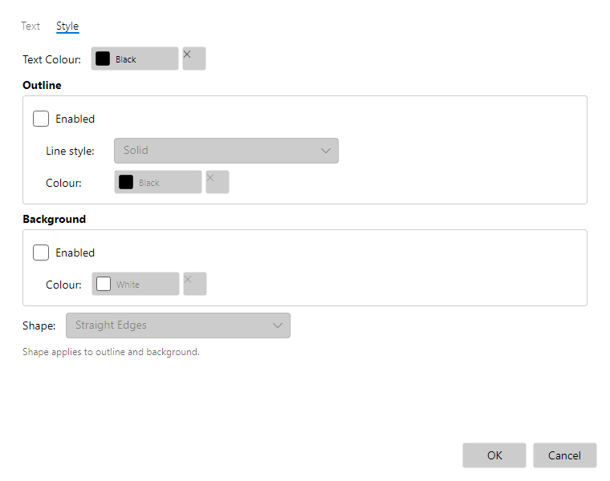

# Labels

[Back to the guide](index.md)

Labels are notes on the map: a title, a list of treasures, a reminder of a puzzle. Press **L** to add one where the
mouse is, or right-click and choose **Add Label**. Double-click a label to edit it.

## Formatting with Markdown

Tick **Markdown** to format the text. You don't need to remember the marks: the toolbar puts them in for you.

- **B**, **I** and **<>** make the selected words bold, italic or code (**Ctrl+B**, **Ctrl+I**).
- **H** makes a heading, the list buttons make a bulleted or numbered list, and **—** draws a line across.
- **Insert Table** puts in a small table to type over.
- **Add Link...** (**Ctrl+K**) lists the map's rooms or objects. Search, pick one and press **Insert Link**, or click
  a room on the map. Click a room link on the map to go to that room.

On the map, the table above looks like this:

If you'd rather type the marks: `## Heading`, `**bold**`, `*italic*`, `- list`, `[[Room name]]` for a room link and
`[words](https://...)` for a web link.

## Styles

A label's look comes from a **style**: "Title", "Note", whatever the map needs. The label's **Style** tab shows the
label's text in each of the map's styles: click the one you want. Change a style and every label using it changes
with it.

**Edit Styles...** opens the styles in Map Settings (see [Settings](settings.md#label-styles)). A style sets the font
and size, bold and italic, the text colour, the outline, the background, the shape (straight edges, rounded,
ellipse or octagon), and where the text sits across and up and down the label. **Usual** is as labels have always
been: centred, or top left for Markdown.

If one label really must be different, choose **Modify this label's appearance...**. It's better to make a style, so
labels stay alike: **Create a New Style...** there makes one with the label's look, and the label then uses it.
**Reset to Style** takes the label back to its style. A label changed this way says so on the Style tab, but the
controls stay hidden until you choose Modify again.

## Size

A label grows as you type, and shrinks back as you delete, but never smaller than you made it. Drag its handles to
resize it yourself.

Labels can be joined to rooms like a room can, and appear in image and PDF exports. They aren't exported to game
source.

Next: [Automap](automap.md)
