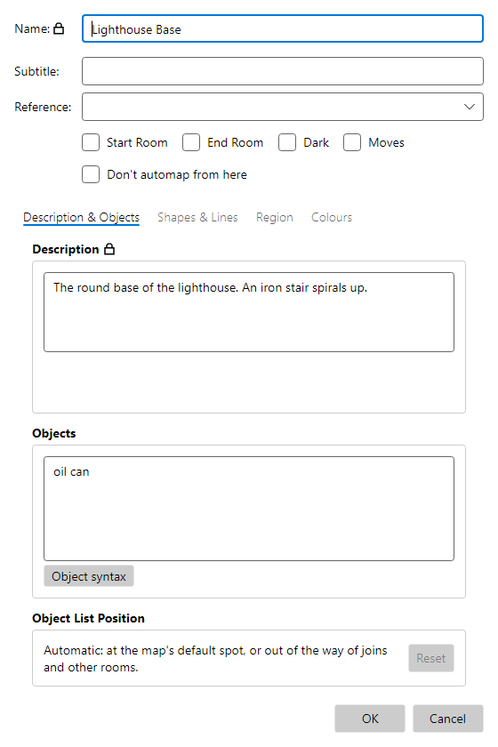
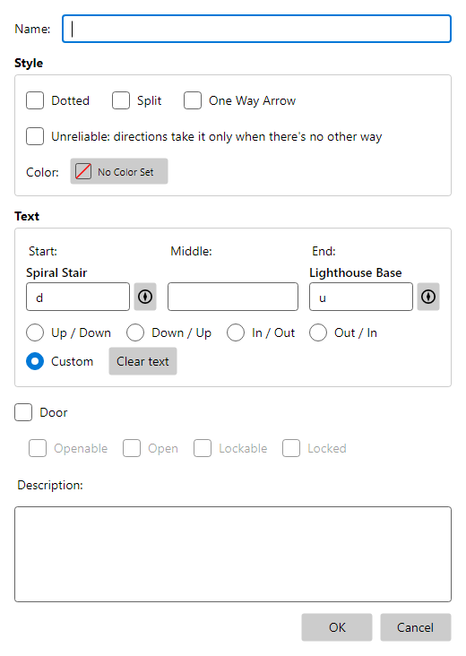
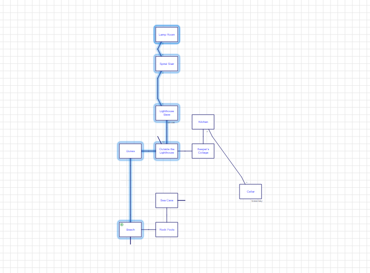

# Drawing the map

[Back to the guide](index.md)

## Rooms

- **Add a room:** double-click an empty spot, press **R**, or right-click and choose **Add Room**.
- **Rename it:** press **F2**.
- **Its properties:** double-click it, or press **Alt+Enter**.

The **Description & Objects** tab holds the room's description and what's in it, one object a line. The other tabs
set its shape, lines, region and colours. **Start Room**, **End Room** and **Dark** change how it's drawn (a dark
room is shaded).

A padlock beside the name means automap drew this room and knows it again by its name and description. Click the
padlock to unlock them if you need to change them.

## Joins

A join is a way from one room to another. Drag from a room's port (the dots round its edge) to another room, or
press **J** to join the selected rooms. Double-click a join to open its properties.

- **Text** labels each end ("u" and "d" here) and the middle. The buttons below fill in the usual pairs.
- **One Way Arrow** for a way you can't come back along.
- **Dotted** for a way you're not sure of, **Split** to draw a long join as a short stub at each end
  ("to Building").
- **Unreliable** for a way that doesn't always lead where it's drawn (the game picks at random). Directions only
  take it when there's no other way.
- **Door** for a door, which can be openable, lockable and so on. This is used when exporting to game source.

To bend a join, select it and drag the handle in its middle.

## Regions

A region is a group of rooms drawn in their own colours: "Above ground", "The cellars". Set them up in
**Map Settings > Regions**, then choose **Change Region** (**Shift+F2**) on a room. **Ctrl+Shift+A** selects every
room in the regions you pick.

## Selecting and tidying

- Drag a box round rooms to select them, or **Ctrl+click** to add one at a time. **Ctrl+A** selects everything.
- The **number pad** selects the room in that direction. **Ctrl+arrow** does too, or, if there's no room that way,
  adds one and joins it: a quick way to sketch a map from the keyboard.
- **Tidy Map...** (Edit > Rooms) lines the rooms up and untangles the joins: the whole map, or just the rooms you've
  selected. Rooms you've placed yourself stay where you put them.
- **Merge Rooms** turns two copies of a place into one. **Split Room...** turns one room into two.

## Directions

Need to get from one room to another? Right-click where you want to go and choose **Navigate to Here**. The
**Directions** panel lists the commands to type, and the route glows on the map.

- While automapping, the directions start from where you are, and follow you as you play.
- Otherwise, choose **Navigate from Here...** on the room to start from.
- **Copy Commands** copies them, one a line, to paste into the game.
- Right-click a step and choose **Avoid This Route** to go another way.

Next: [Labels](labels.md)
