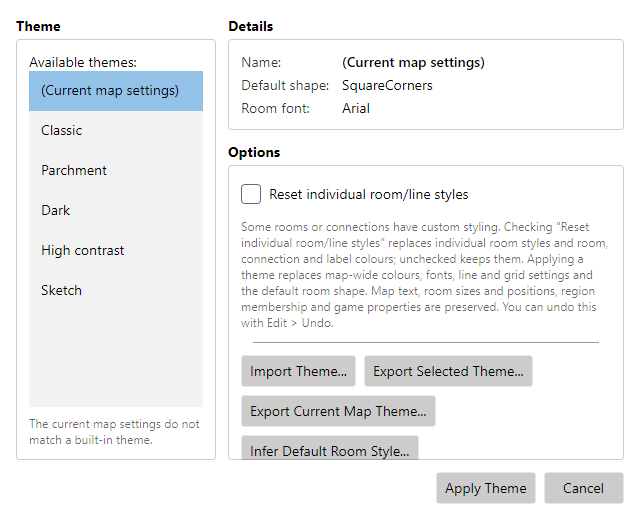

# Settings

[Back to the guide](index.md)

There are two kinds of settings:

- **App settings** (Edit > Application Settings..., **Ctrl+,**) are yours: they apply to every map you open.
- **Map settings** (Edit > Map Settings..., **Ctrl+Shift+,**) are saved in the map, so anyone who opens it sees it the
  same way. A new map starts with the defaults; **Edit > Restore Default Map Settings** puts them back (one undo
  step).

## App settings

**General:**

- **Save images at 100%**: export pictures at full size, whatever the zoom.
- **Open last project on start**, and **Keep a recovery copy of unsaved changes** (on by default) in case Recast
  closes before you save.
- **Invert Mouse Wheel Zoom**, and **Scroll wheel / trackpad scroll**: **Automatic** zooms with a mouse wheel and pans
  with a trackpad, or choose **Always zoom** or **Always pan**. **Ctrl** with the wheel always zooms.
- **Show Full Path in Title Bar.**
- **Port Adjust Detail**: how many ports **Adjust Ports** (**;**) chooses from: the four sides, the corners too, or all
  sixteen.
- **Smart Save**: whether **Smart Save** (**Ctrl+Alt+S**) also saves a PDF and an image, and which image type. **Save
  TADS to ADV3Lite** writes TADS exports for the adv3Lite library.
- **App defaults**: the font for new maps, and margins round exported pictures (unless a map sets its own).

**Tooltips:** whether hovering over the map shows tooltips, and whether they include objects and descriptions (and how
many letters of a description).

**Map:**

- **Apply style to new rooms** makes each new room copy the look of the last room you selected.
- **Where you are**: the token that marks where you are while automapping: a wooden disc, a brass coin, a pawn, a
  "you are here" sign, painted or pewter figures, or **your own** (a PNG with a transparent background, or an SVG).
  Untick **Token on the room** to hide it. **Glow round the room** sets the colour of the glow.

### Updates

When a new version of Recast is out, a bar appears under the toolbar a few seconds after Recast starts. **Help >
Check for Updates...** looks straight away. **Updates**, on the **General** tab, chooses what happens:

- **Check for updates, but let me choose whether to download and install them**: the bar says a new version is
  out, with **Download** and **What's New** (the release notes).
- **Download updates, but let me choose when to install them** (the default): it downloads in the background, then
  offers **Restart to Update**. That closes Recast as usual (asking to save your map first), installs the new version
  and opens it again. Nothing is installed until you choose it: close Recast or choose **Later**, and the bar offers
  it again next time.
- **Install updates automatically**: it downloads in the background and installs the new version when you close
  Recast. **Restart Now** on the bar does it straight away.

**Get test versions (betas)** gets new versions before they're released, with the newest features and sometimes
problems. Without it you get full releases only. Until you choose, a beta gets betas and a full release gets full
releases, so a beta moves on to the full release when it's out. Turn it off while on a beta and Recast offers to go
back to the last full release (**Restart to Go Back** on the bar), or you can stay on the beta until the next full
release.

Only installed copies update themselves (see [Getting started](getting-started.md#download-and-install)). In a plain
copy from a zip, the Updates settings say it can't update itself and which download to install on your computer, as
does **Check for Updates**. Install Recast from there and your settings come with you.

## Map settings

### Map Details

The map's **title**, **author**, **description** and **history**. They're saved in the map, and game source exports
use them: the title and author for the game's name and byline, and the description as its headline.

### Lines & Grid

- **Hand-drawn style** gives the whole map a sketched look: rooms, joins and labels drawn with a gentle pen-like
  wobble. A room can be set straight or hand-drawn in its own properties.
- **Width** of lines, and **Arrow Size** on one-way joins.
- **Room Arrow Stalk Length**: a join leaves a room straight out from its port for this far before heading off.
- **Text Offset From Line**: the gap between a join and its labels.
- **Preferred Distance Between Rooms**: how far apart automap and **Ctrl+arrow** put new rooms.
- **Join labels:** whether to write the direction at the end of a join leaving from a side (N, E, S, W) or a corner
  (NE, SE, SW, NW) when it has no label of its own, and whether to show up and down. **Direction words** draws
  directions "n" or "north" (or as written), whichever way each label was typed. Only the drawing changes. The
  preview shows the result.
- **Grid:** shown or not, its size, whether rooms and joins **snap to** it, and a faint cross at the middle of the
  map (**Show Origin**).

### Rooms & Editing

- **Default Room Text**, the name a new room starts with, and its **Default Shape**.
- **Darkness Stripe Size**: the dark corner on a dark room.
- **Object List Offset**, and **Object List Position**: drag the sample list to where object lists go, beside a side
  or corner of the room or inside it.
- **Advanced:** the size of handles and ports, and how near you must click to pick something
  (**Snap to Element Distance**). Make it bigger if things are hard to pick up.
- **Margins:** **Wrap Text at Dashes**, and margins round this map's exported pictures.

### Colours

The map's colours: the canvas, room borders, joins (and joins selected or under the mouse, which don't show in
exports), subtitle, object and join text, the grid, and the start and end rooms. Rooms take their fill and name
colour from their region.

### Fonts

The fonts for room names, objects, joins and subtitles. Someone opening the map without a font sees another one
instead.

### Regions

**Add Region**, **Delete Region** (its rooms go to No Region), and each region's name, fill and text colour. **No
Region** can't be renamed, but you can change its colours. Region names can't differ only in capitals. A dark fill
needs a light text colour: Recast leaves that to you.

### Styles

The map's label styles. Every map has **Default**. **New Style** makes one **based on** the
style that's selected: it looks the same until you change something. What it doesn't set comes from the style it's
based on, and the tab says where ("from Title"). **Reset** takes a value from there again. Delete a style and its
labels take the style it was based on.

Styles are saved in the map. Older versions draw each label as it looks now.

## Themes

A theme changes the whole look of a map in one go: Classic, Parchment, Dark, High contrast or Sketch. Choose
**Edit > Map Theme...**.

- **A theme** sets the map's colours, fonts, region colours, default room shape, hand-drawn style, line sizes, grid and
  margins. It never changes your rooms, joins, names or layout. Regions are matched by name.
- **Reset individual room/line styles** also clears colours and shapes you've set on single rooms and joins.
- **Export Selected Theme...** and **Export Current Map Theme...** save a `.trizbort-theme` file to share, and
  **Import Theme...** reads one. A theme needs its fonts installed.
- **Infer Default Room Style...** helps when every room was styled by hand: it finds the look most rooms share and
  makes it the map's default, so a theme exported afterwards carries it. A preview lists the changes first.

Applying a theme is one undo step.

Next: [Exporting](exporting.md)
