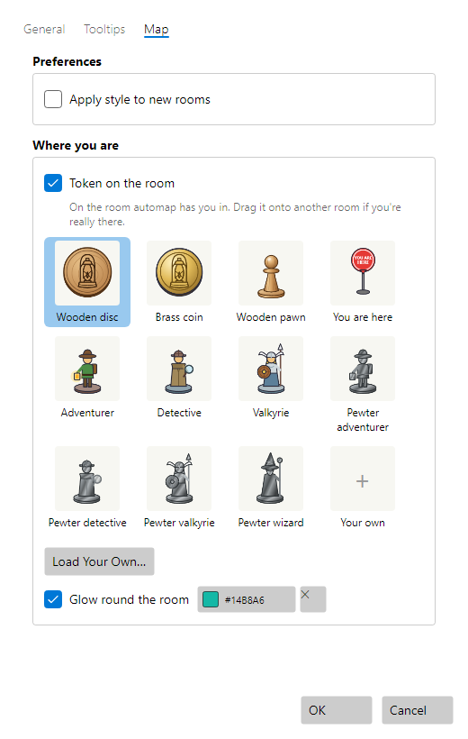
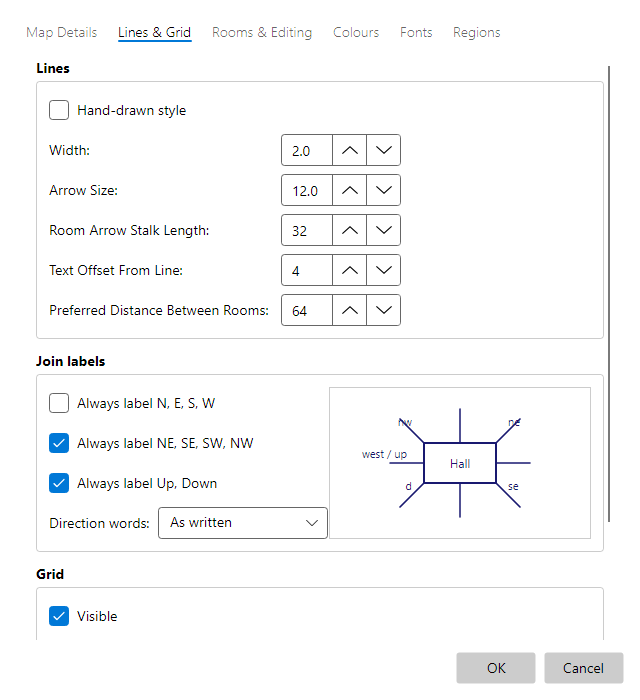
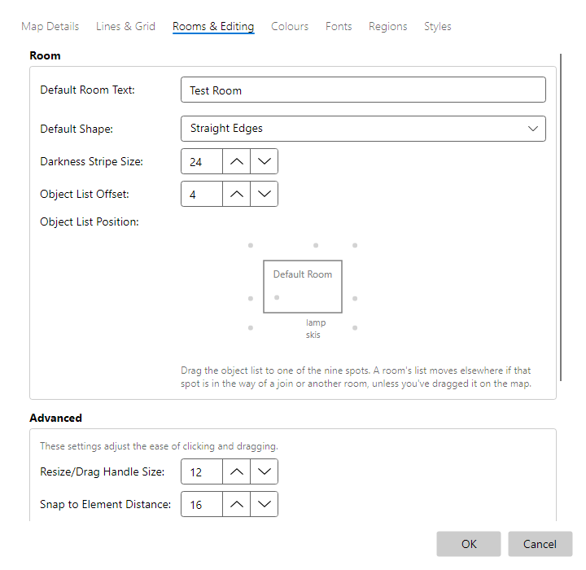

# Settings

[Back to the guide](index.md)

There are two kinds of settings:

- **App settings** (Edit > Application Settings..., **Ctrl+,**) are yours: they apply to every map you open.
- **Map settings** (Edit > Map Settings..., **Ctrl+Shift+,**) are saved in the map, so anyone who opens it sees it the
  same way.

## App settings

The **General** tab has your preferences: whether to open the last map when Recast starts, keep a recovery copy of
unsaved changes (on by default), and how the mouse wheel and trackpad zoom and scroll.

The **Map** tab chooses the token that marks where you are while automapping: a wooden disc, a brass coin, a pawn, a
"you are here" sign, painted or pewter figures, or **your own** (a PNG with a transparent background, or an SVG).
Untick **Token on the room** to hide it. **Glow round the room** sets the colour of the glow.

**Apply style to new rooms** makes each new room copy the look of the last room you selected.

### Updates

When a new version of Recast is out, a bar appears under the toolbar a few seconds after Recast starts. **Help >
Check for Updates...** looks straight away. **Updates**, on the **General** tab, chooses what happens:

- **Check for updates, but let me choose whether to download and install them**: the bar says a new version is
  out, with **Download** and **What's New** (the release notes).
- **Download updates, but let me choose when to install them** (the default): it downloads in the background, then
  offers **Restart to Update**. That closes Recast as usual (asking to save your map first), installs the new version
  and opens it again. Nothing is installed until you choose it: close Recast or choose **Later**, and the bar offers
  it again next time.
- **Install updates automatically**: it downloads in the background and installs the new version when you close
  Recast. **Restart Now** on the bar does it straight away.

While Recast is in beta, it updates to the newest beta.

Only installed copies update themselves (see [Getting started](getting-started.md#download-and-install)). In a plain
copy from a zip, the Updates settings say it can't update itself and link to the Releases page, as does **Check for
Updates**. Install Recast from there and your settings come with you.

## Map settings

| Tab | What it sets |
|---|---|
| Map Details | The map's title, author, description and history |
| Lines & Grid | Line width and arrows, how joins are labelled, and the grid |
| Rooms & Editing | The default room shape, where object lists go, handle sizes |
| Colours | The colours of the canvas, rooms, joins and text |
| Fonts | The fonts for room names, subtitles, objects and join labels |
| Regions | Regions and their colours |

**Direction words** chooses how join labels write directions: "n" or "north", or as written. The preview shows the
result as you change it.

## Themes

A theme changes the whole look of a map in one go: Classic, Parchment, Dark, High contrast or Sketch. Choose
**Edit > Map Theme...**.

Tick **Reset individual room/line styles** to also clear colours you've set on single rooms and joins. You can share
a theme with **Export Selected Theme...** and **Import Theme...**. Applying a theme is one undo step.

Next: [Exporting](exporting.md)
