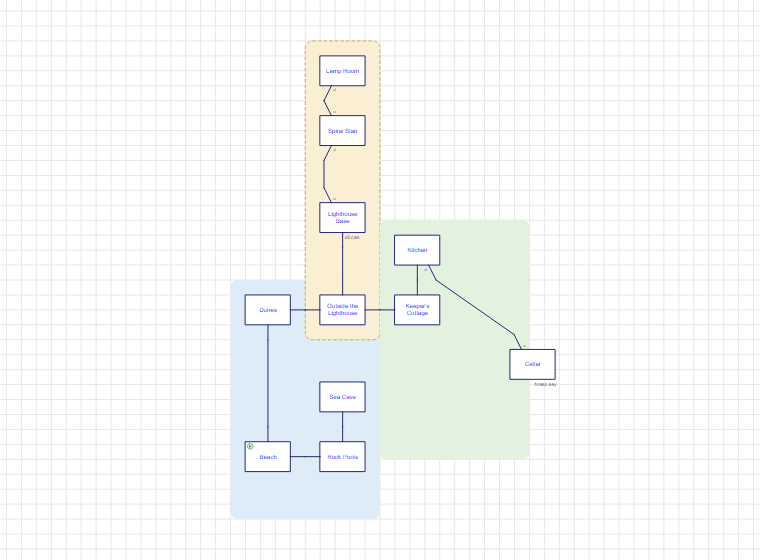
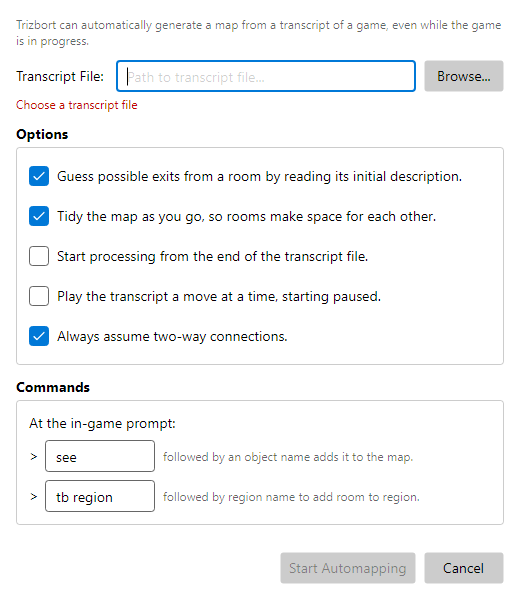
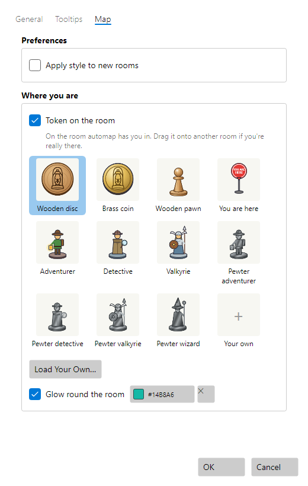
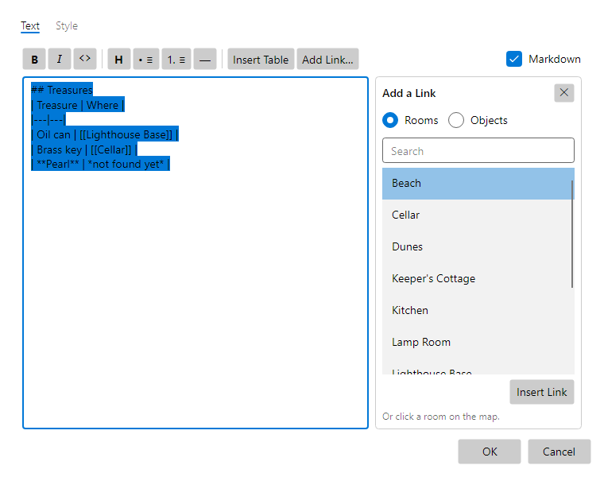
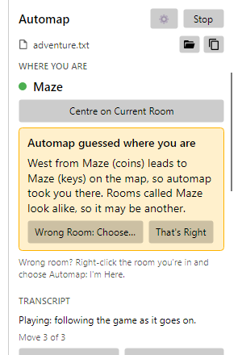
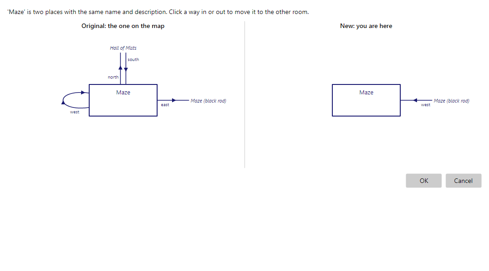
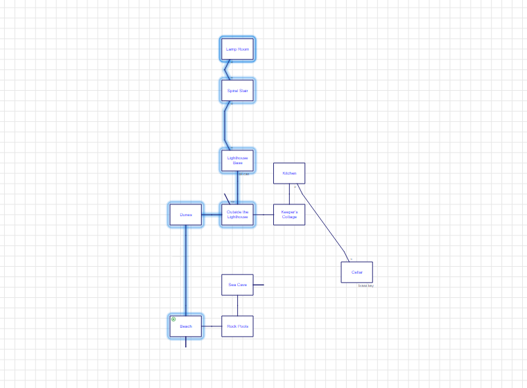
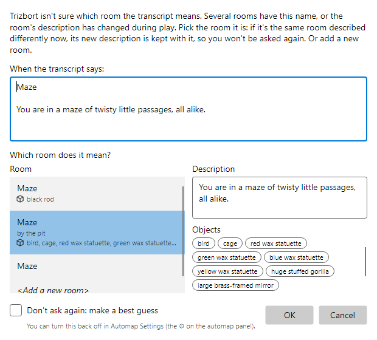
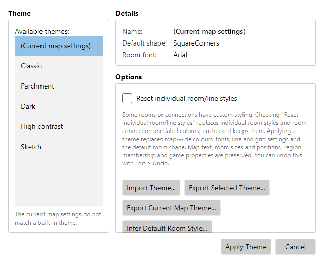

# What's new

[Back to the guide](index.md)

The highlights of each release, newest first. Every change is listed in the [changelog](../changelog.md).

## Coming next

- **Label styles.** Choose a style for each label, such as "Title" or "Note", with its font and size, colours,
  outline, background and shape. A style can be based on another. Change a style and its labels change too. See
  [Labels](labels.md#styles).
- **Backgrounds**: coloured shapes behind parts of the map, to set them apart. Select some rooms and press **B**.
  See [Drawing the map](map.md#backgrounds).

- **Add New Region...** on a room's **Set Region** menu makes a region for the selected rooms, and the default region
  is called **No Region**.
- **Assume joins go both ways** is the new name for "Always assume two-way connections", and each option in the
  automapping dialog has an **ⓘ** to hover over for more about it.
- **A shorter automapping dialog.** The game screen is shown or hidden on the automap panel, and join labels follow
  the map's **Direction words** setting.

## 0.15 (22 November 2026)

**You are here.** The room automap has you in carries a token, like a playing piece on a board, and glows. Drag the
token to put automap right. Choose your token in App Settings, or load your own.

**Markdown labels.** Headings, bold, lists, tables, and links to rooms you can click. A toolbar puts the marks in for
you, and the label grows to fit.

**Automap says when it guessed.** When it picks a room for you and it could be another, the panel says what it
guessed and why, with **Wrong Room: Choose...** to fix it.

Also: **Unreliable joins** for ways that don't always lead the same place, and **Split Room** now draws both rooms
as the map does.

## 0.14 (16 November 2026)

**Directions**, like a satnav: right-click a room and choose **Navigate to Here**. The route glows on the map, and
follows you as you play.

Also: **Automap Settings** can be changed while automap runs (the ⚙ on the panel), **Play to the End** shows its
progress, and each tidy is an undo step of its own.

## 0.13 (15 November 2026)

**The map rethinks itself.** When a move shows the map was laid out the wrong way round, automap lays it out again,
and the rooms slide to their new places. Layouts are tidier and better balanced, and rooms you placed yourself stay
put.

**Split Room...** for a room that turns out to be two places with one name, and a bigger game screen in the automap
panel.

## 0.12 (10 November 2026)

**The automap panel** gathers automap's controls beside the map: where you are, the transcript, and mapping or
tracking only.

Also: **rooms that move** (lifts, cars), **Merge Rooms**, **Split Join** to tidy away long joins, darkness, and
**Which room does it mean?** showing the room you pick on the map behind it.

## 0.11 (8 November 2026)

**Renamed Trizbort: Recast.** Rooms **tidy themselves** as you explore, and **Tidy Map...** tidies the whole map.
Play a transcript **move by move**, and watch the game on a small **game screen**.

## 0.10 (2 November 2026)

**Recovery copies** of your unsaved work after a crash, and plainer error messages. Automap follows magic words
(`xyzzy`) and lists several ways between two rooms on one join.

## 0.9 (31 October 2026)

**The first beta of Recast**: the same app on Windows, Linux and macOS. **Undo and redo** for every change, trackpads
and touchscreens, and sharp, searchable PDF export.

## Before Recast

Trizbort 2 added map labels, curved joins and themes to the original Windows app. See
[the original guide](../legacy/Docs/index.md).

