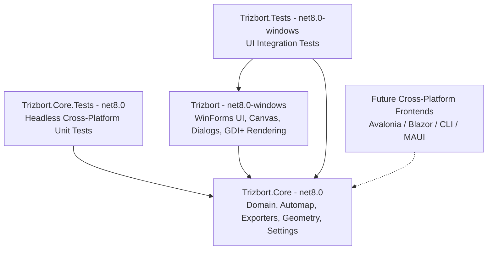

# Plan: Extract Trizbort.Core and Headless Tests

# Requirements

### Overview & Goals
To maximize long-term maintainability, reuse, and cross-platform flexibility with minimal computational and development friction:
- Decouple all domain logic, serialization, export generation, and automap parsing into a standalone `Trizbort.Core` class library (`net8.0`).
- Create an independent `Trizbort.Core.Tests` (`net8.0`) test suite validating pure core behaviors without Windows Forms or GDI+ dependencies.
- Adopt an incremental, component-by-component migration strategy where each slice is made platform-agnostic, verified via compilation and passing unit tests, and committed atomically immediately upon verification.
- Enforce the practice of immediate commits once changes are building and tests are passing, preventing accumulation of unrelated changes in the working directory.
- Preserve the existing `Trizbort` Windows Forms application by having it consume `Trizbort.Core` through clean adapter seams.

### Scope
- **In Scope:**
  - Stabilizing the working tree state (`src/Trizbort.Core/`, `src/Trizbort.Core.Tests/`) so cross-platform compilation and test execution succeed immediately.
  - Incrementally extracting each major component (Geometry/Math, Exporters, Automap engine, Domain Elements & Persistence, Settings/Themes) into platform-neutral code in `src/Trizbort.Core/`.
  - Migrating pure unit tests to `src/Trizbort.Core.Tests/` and retaining UI-bound tests in `src/Trizbort.Tests/`.
  - Updating WinForms UI adapters and referencing `Trizbort.Core` cleanly in `src/Trizbort/`.
  - Updating architectural references in `agent-docs/`.
- **Out of Scope:**
  - Building a new frontend (Avalonia, MAUI, Web/Blazor) in this extraction phase.
  - Altering the `.trizbort` file schema or breaking backward compatibility with existing map files.

### Functional Requirements
- `Trizbort.Core.dll` must build targeting `net8.0` with standard SDK style (`Microsoft.NET.Sdk`) without `<UseWindowsForms>true</UseWindowsForms>`.
- `Trizbort.Core.Tests.dll` must execute all unit tests cross-platform on any OS with the .NET 8 runtime installed (`dotnet test src/Trizbort.Core.Tests/Trizbort.Core.Tests.csproj`).
- When making any component change, as soon as it is fixed up, compiling, and tests are passing, commit the changes immediately before proceeding to the next component. Do not build up a working tree of unrelated changes.
- The existing Windows Forms application (`Trizbort.exe`) must continue to compile and run on Windows referencing `Trizbort.Core`.

# Technical Design

### Current Implementation & Boundaries
- **Project Structure**:
  - `src/Trizbort.Core/Trizbort.Core.csproj` (`net8.0`, pure SDK library, platform-neutral).
  - `src/Trizbort.Core.Tests/Trizbort.Core.Tests.csproj` (`net8.0`, headless cross-platform test runner).
  - `src/Trizbort/Trizbort.csproj` (`net8.0-windows`, Windows Forms UI client).
  - `src/Trizbort.Tests/Trizbort.Tests.csproj` (`net8.0-windows`, WinForms-specific UI/Canvas tests).

### Key Decisions & Rationale
1. **Incremental Component-by-Component Extraction & Immediate Commits**: Breaking down the port into modular, independently validated stages minimizes regression risk, ensures deterministic test feedback, and delivers immediate utility. Committing immediately once a slice builds and tests pass prevents accumulating unrelated working tree changes.
2. **Platform-Agnostic Abstractions**: Drawing primitives and OS-specific types (e.g. `System.Drawing.Font`, `Color`, `PointF`) are replaced with lightweight core value objects (`Vector`, `Rect`, portable font metadata) or abstraction interfaces (`IAutomapCanvas`, `IUserInteraction`). GDI+ concrete object instantiation is confined strictly to the WinForms layer.
3. **Friend Assembly Access for Test Seams**: Grant `InternalsVisibleTo("Trizbort.Core.Tests")` in `Trizbort.Core` to permit rigorous unit testing of automap and domain internals without compromising encapsulation for consumer frontends.
4. **Session-Friendly Modular Boundaries**: Clear component boundaries allow discrete agent sessions to load and work on focused subtrees without consuming large context windows or processing redundant codebase files.

### Architecture Diagram

### File & Namespace Organization
- **`Trizbort.Core`**:
  - `Domain/`: `Elements/` (`Room`, `Connection`, `Door`, `MapLabel`), `Application/` (`Project`, `LegacyMapFileEngine`), `Commands/`, `Controllers/`, `Misc/` (`Vector`, `Rect`, `Colors`, `DrawingContext`).
  - `Automap/`: `Automap.cs`, `AutomapSettings.cs`, `IAutomapCanvas.cs`, `AutomapCanvas.cs`.
  - `Export/`: `CodeExporter.cs`, `Inform7Exporter.cs`, `TadsExporter.cs`, `HugoExporter.cs`, `ZilExporter.cs`, etc.
  - `Setup/`: `Settings.cs`, `MapTheme.cs`, `RoomStyleInference.cs`.
  - `Util/`: `XmlScribe.cs`, `XmlElementReader.cs`, `XmlAttributeReader.cs`.
- **`Trizbort` (WinForms App)**:
  - `UI/`: `MainForm.cs`, `Controls/Canvas.cs`, `Controls/Canvas.*.cs`, dialog forms, and GDI+ rendering pipeline.

# Testing

### Validation Approach
Verification is optimized through automated compiler assertions and isolated test execution.

### Key Scenarios
1. **Core Library Build**:
   - Run `/home/lee/.dotnet/dotnet build src/Trizbort.Core/Trizbort.Core.csproj`
   - Outcome: 0 warnings, 0 errors, net8.0 compilation success.
2. **Core Unit Test Execution**:
   - Run `/home/lee/.dotnet/dotnet test src/Trizbort.Core.Tests/Trizbort.Core.Tests.csproj` or `./scripts/run-core-tests.sh`
   - Outcome: All tests pass covering `AutomapRegressionTests`, `GeometryRegressionTests`, `ExporterRegressionTests`, `PersistenceRegressionTests`, `RoomCopyStyleTests`, `MapThemeTests`.
3. **WinForms Solution Build**:
   - Run `/home/lee/.dotnet/dotnet build Trizbort.sln`
   - Outcome: All projects restore and compile cleanly.
4. **End-to-End Test Suite**:
   - Run `/home/lee/.dotnet/dotnet test Trizbort.sln`
   - Outcome: Complete test suite passes across all test projects.

# Context & Token Economy Guide

### Context Summary for Future Agent Sessions
To minimize context load and token usage in subsequent sessions:

- **Agent Development Workflow Rule**:
  - When making a change, once it is fixed up, building, and core tests pass, **commit those changes immediately**.
  - **Do NOT** accumulate a working directory of unrelated changes across different components or domains.
  - Exclude `.junie/` and user-specific files (`*.DotSettings.user`) from git commits.
- **Working on Domain / Logic / Export / Automap**:
  - Focus files strictly under `src/Trizbort.Core/`.
  - Test command: `dotnet test src/Trizbort.Core.Tests/Trizbort.Core.Tests.csproj`
  - Do NOT load WinForms UI classes into context.
- **Working on WinForms UI / Canvas Rendering**:
  - Focus files strictly under `src/Trizbort/UI/` and `src/Trizbort/Drawing/`.
  - Test command: `dotnet test src/Trizbort.Tests/Trizbort.Tests.csproj`
- **Key Reference Types**:
  - `Project.Current`: Central state containing `Elements` (`BoundList<Element>`).
  - `Room`, `Connection`: Primary domain entities.
  - `Vector`, `Rect`: Core 2D geometric representations replacing GDI+ types in Core.
  - `IAutomapCanvas`: Contract decoupling automap parsing from canvas rendering.

# Delivery Steps

### ✓ Step 1: Stabilize Current Working Tree Baseline and Pass Cross-Platform Tests
The working tree compiles cleanly for Trizbort.Core and all portable tests pass and are committed.

- Fix compilation issues in `src/Trizbort.Core/Automap/AutomapCanvas.cs` (`CompassPointHelper`, `Element.Size` / geometry access).
- Add `[assembly: InternalsVisibleTo("Trizbort.Core.Tests")]` and `[assembly: InternalsVisibleTo("Trizbort")]` where required to resolve internal access blockers.
- Remove UI-bound dependencies (`System.Windows.Forms`, `PdfSharp`, `Trizbort.UI`) from `src/Trizbort.Core.Tests/` (move UI-specific test cases to `src/Trizbort.Tests/`).
- Validate that `/home/lee/.dotnet/dotnet build src/Trizbort.Core/Trizbort.Core.csproj` and `/home/lee/.dotnet/dotnet test src/Trizbort.Core.Tests/Trizbort.Core.Tests.csproj` succeed.
- Commit the baseline working tree checkpoint.

### ✓ Step 2: Decouple and Migrate Math, Geometry, and Utility Components
Geometry and utility components in Trizbort.Core are fully platform-neutral and verified by tests.

- Replace `System.Drawing.PointF`/`SizeF` usages in `src/Trizbort.Core/Domain/Misc/` (`Vector.cs`, `Rect.cs`, `Sketch.cs`, `LineSegment.cs`) with core geometric primitives.
- Ensure XML and attribute utility classes (`XmlScribe.cs`, `XmlElementReader.cs`, `XmlAttributeReader.cs`) are pure and fully verified in `src/Trizbort.Core.Tests/`.
- Run `/home/lee/.dotnet/dotnet test src/Trizbort.Core.Tests/Trizbort.Core.Tests.csproj` covering geometry regression tests.
- Commit the geometry and utility component migration.

### ✓ Step 3: Decouple and Migrate Exporter and Serialization Components
Exporters and map persistence operate purely in Trizbort.Core with comprehensive test coverage.

- Verify all code exporters (`Inform7Exporter`, `TadsExporter`, `HugoExporter`, `ZilExporter`, `QuestExporter`, `AlanExporter`, etc.) in `src/Trizbort.Core/Export/` expose public/clean APIs without UI coupling.
- Verify map serialization/deserialization (`MapLoader.cs`, `LegacyMapFileEngine.cs`) round-trips correctly on `net8.0`.
- Execute exporter regression and persistence unit tests in `src/Trizbort.Core.Tests/`.
- Commit the exporter and serialization component migration.

### ✓ Step 4: Decouple and Migrate Automap Engine and Domain Models
Automap parsing, room connectivity, and core domain entities operate independently of UI controls.

- Ensure `Automap.cs`, `AutomapSettings.cs`, and `AutomapCanvas.cs` interact via `IAutomapCanvas` and core geometric primitives without WinForms dependencies.
- Verify domain elements (`Room.cs`, `Connection.cs`, `Door.cs`, `MapLabel.cs`) and `Project.cs` contain pure domain logic.
- Execute `AutomapRegressionTests.cs` and domain tests in `src/Trizbort.Core.Tests/`.
- Commit the automap engine and domain model migration.

### ✓ Step 5: Decouple Settings, Map Themes, and Reintegrate WinForms Client
Settings and themes use platform-neutral metadata and the WinForms host compiles cleanly against Core.

- Replace `System.Drawing.Font` references in `src/Trizbort.Core/Setup/Settings.cs` and `MapTheme.cs` with portable font metadata (family, size, style, unit), moving GDI+ font construction to WinForms.
- Update WinForms controls (`MainForm.cs`, `Canvas.cs`, dialogs, and drawing extensions) to adapt to the extracted Core APIs and font metadata.
- Verify that `src/Trizbort/Trizbort.csproj` builds and `src/Trizbort.Tests/Trizbort.Tests.csproj` passes on Windows.
- Commit the settings, theme decoupling, and WinForms adapter integration.

### ✓ Step 6: Update Architecture Documentation and Perform Full Verification
Technical documentation reflects the modular architecture and the complete solution builds and tests cleanly.

- Update `AGENTS.md` and `agent-docs/README.md` to document the immediate commit rule: once a change is fixed up, building, and tests pass, commit immediately rather than building up unrelated changes.
- Update `agent-docs/01-architecture-overview.md`, `agent-docs/09-build-test-and-dotnet8-port.md`, and relevant component docs in `agent-docs/` to reflect `Trizbort.Core` and `Trizbort.Core.Tests`.
- Execute full solution build (`dotnet build Trizbort.sln`) and test passes (`dotnet test Trizbort.sln`).
- Commit the documentation updates and final extraction verification.
